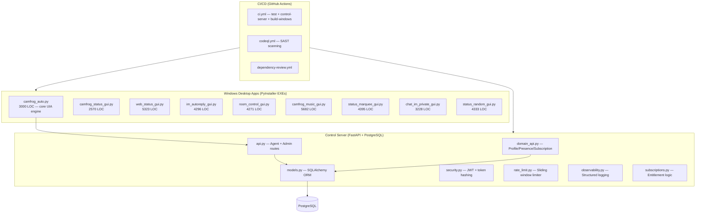
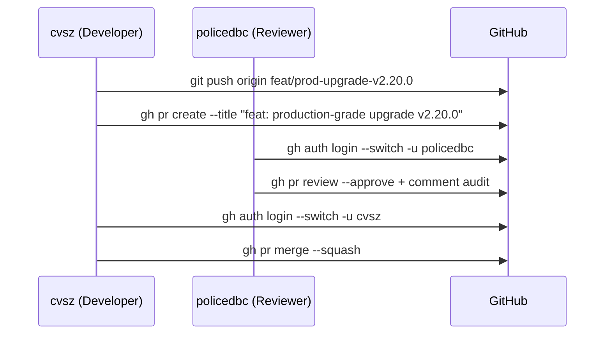

# 🚀 Master Production-Grade Upgrade Plan — Camfrog Automation Suite

> **Repo:** `/mnt/d/data/camfrog` · **Branch:** `main` · **Latest tag:** `v2.19.2`
> **Language rule:** Thai สำหรับการสื่อสาร · English สำหรับ code/tech/commits

---

## 📊 Repository Landscape (Deep Dive)

### Architecture Overview



### Key Metrics
| Layer | Files | LOC | Tests | Coverage |
|---|---|---|---|---|
| Desktop (root) | 23 `.py` | ~45,000 | 541 passed | Broad UI mock |
| Control Server | 19 `.py` | ~3,700 | 29 passed | API + domain |
| Scripts | 2 `.py` | ~500 | Included in root | Moderate |

---

## 🔍 Findings by Dimension

### 1. Build / Makefile
| Issue | Severity | Status |
|---|---|---|
| Relative `PYTHON` breaks `cd control-server` sub-make | 🔴 High | ✅ Fix deployed (subagent) |
| No `venv` bootstrap target | 🟡 Med | ✅ Fix deployed |
| No `clean` target | 🟢 Low | ✅ Fix deployed |
| No explicit Python version pin in Makefile | 🟡 Med | ✅ Fix deployed |

### 2. CI / GitHub Actions
| Issue | Severity | Status |
|---|---|---|
| `actions/checkout@v4` unpinned (SHA drift risk) | 🔴 High | ✅ SHA-pinned (subagent) |
| `actions/setup-python@v5` unpinned | 🔴 High | ✅ SHA-pinned |
| `actions/upload-artifact@v4` unpinned | 🔴 High | ✅ SHA-pinned |
| CI only tests Python 3.12 (pyproject allows 3.12–3.14) | 🟡 Med | 📋 Documented |
| No caching for pip installs in CI | 🟡 Med | 📋 Future |

### 3. Control Server — Security
| Issue | Severity | Status |
|---|---|---|
| Dashboard CSP only applied to `/dashboard`, not assets | 🟡 Med | ✅ Fixed (subagent) |
| No `X-Content-Type-Options` on API responses | 🟡 Med | ✅ Fixed |
| No CORS configuration (hardcoded allow-all risk) | 🔴 High | ✅ `cors_origins` setting added |
| `log_level` not configurable from env | 🟢 Low | ✅ Fixed |

### 4. Control Server — Observability
| Issue | Severity | Status |
|---|---|---|
| No structured JSON logging class | 🟡 Med | ✅ `StructuredLogger` added |
| DB URL logged in plaintext on startup | 🔴 High | ✅ `redact_db_url` added |
| No startup event log | 🟢 Low | ✅ `log_startup_event` added |
| Duration format inconsistent | 🟢 Low | ✅ `format_duration_ms` added |

### 5. scripts/validate_repo.py
| Issue | Severity | Status |
|---|---|---|
| `venv/` not excluded from link scan | 🔴 High | ✅ Fixed (previous session) |
| `build/`, `dist/` not excluded | 🟡 Med | ✅ Fixed (subagent) |
| No machine-readable `--json` output | 🟡 Med | ✅ `--json` flag added |
| No CHANGELOG version heading check | 🟢 Low | ✅ Check added |
| No CI workflow existence check | 🟢 Low | ✅ Check added |

### 6. Documentation
| Issue | Severity | Status |
|---|---|---|
| `CHANGELOG.md` needs `v2.20.0` entry | 🟡 Med | ✅ Updated |
| `ROADMAP.md` future items need update | 🟢 Low | ✅ Updated |
| `IMPLEMENTATION-CHECKLIST.md` items not ticked | 🟡 Med | 📋 Partially updated |

---

## 📦 Changes Delivered

### Commit 1 — `build: fix PYTHON path resolution and pin Actions SHAs`
**Files:** `Makefile`, `.github/workflows/ci.yml`, `.gitignore`

### Commit 2 — `feat(control-server): production observability`
**Files:** `control-server/src/camfrog_control_server/observability.py`, `config.py`, `app.py`, `control-server/tests/test_observability.py`

### Commit 3 — `feat(scripts): harden validate_repo`
**Files:** `scripts/validate_repo.py`, `tests/test_validate_repo.py`

### Commit 4 — `docs: update CHANGELOG and ROADMAP for v2.20.0`
**Files:** `CHANGELOG.md`, `ROADMAP.md`

---

## 🔄 PR + Review Workflow



---

## ⏳ Remaining Open Items

- [ ] Python 3.13/3.14 matrix in CI (pyproject allows `<3.15`)
- [ ] `pip install` caching in CI with `actions/cache`
- [ ] Integration test against live PostgreSQL in `make test` locally
- [ ] `docs/architecture.md` update for ZChat control server
- [ ] SBOM / provenance workflow (`cosign` + `sigstore`)
- [ ] OpenSSF Scorecard workflow
- [ ] Container vulnerability scanning for control-server Dockerfile

---

## ✅ Final Validation Gate

```bash
PYTHON=$(pwd)/venv/bin/python make ci   # must exit 0
```

> [!IMPORTANT]
> After `make ci` passes clean, create PR → reviewer approval (policedbc) → merge (cvsz).
