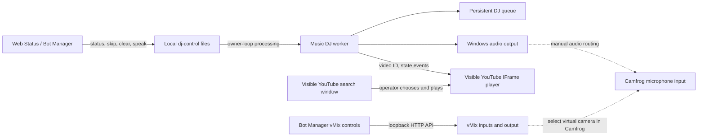

# Bot Manager, Music DJ, YouTube, and vMix

Status: source implementation is present for the local Music DJ controls, a visible YouTube iframe player connected to the DJ queue, and local vMix input control. Windows packaging, browser playback, a Camfrog room audio check, and physical camera acceptance have not been verified from this Linux checkout.

## What owns each job

`web-status.exe` contains the Camfrog Bot Manager client and its local media controls. Camfrog-hosted Room, Profile, and Plugins pages stay remote: the client reads and submits the forms Camfrog returns. The standard catalog exposes 15 server-installed plugins (IDs 1–9 and 11–16); these forms configure those installed plugins. They do not install or host custom plugin code.

`music-dj.exe` remains the only owner of its room listener, persistent DJ queue, requester/owner skip rules, and local audio playback. The two executables do not import each other. The Bot Manager page controls the packaged Music DJ executable through bounded JSON request and response files in the Music DJ app's `dj-control/` directory. The Music DJ worker checks requests on its owner loop, so chat commands and local Skip/Clear actions are serialized against the same queue. Requests expire after 30 seconds. The UI can request status, skip the current track, clear the queue, submit bounded voice text, and start or stop the worker.

The standalone Music DJ window is branded **ZeaZDev room** and includes the microphone mascot at `assets/zeazdev-room.png`. The Windows build embeds this artwork inside the one-file executable.

The `!randommusic` command selects a music search phrase, posts a `https://www.youtube.com/results` link, and stores up to 200 generated entries in `youtube_random_music.json` under the Music DJ data folder. The link opens search results; the operator chooses a video in the visible browser.

`!current` reports the current title, requester, elapsed and total time when known, and next queued song. The Music tab and Bot Manager offer Windows TTS controls for custom text; the Music tab can also speak the current queue summary. TTS uses the installed `System.Speech` voice and Windows default playback device. To make the room hear it, route that output to the Camfrog microphone input with a virtual audio cable or Stereo Mix. The action is local-operator initiated and limited to 240 printable characters.

The `web_status_media.json` file stores the selected `music-dj.exe` path and vMix local address. It contains no Camfrog session data. If the apps were installed as separate release assets, use **Browse** to select the Music DJ executable. The all-features zip preserves the packaged `web-status/` and `music-dj/` directory layout so Bot Manager can try the sibling Music DJ package automatically.

## Music DJ controls in Bot Manager

Open **Bot Manager → Music DJ**. Choose `music-dj.exe` if it was not found automatically. **Open Music DJ** opens its configuration window; use that window to set up and check the Camfrog selectors, room commands, audio backend, and music folder. **Start DJ worker** and **Stop DJ worker** call the packaged app's existing start/stop commands. **Refresh queue**, **Skip current**, **Clear queue**, and **Speak to room** use the local control channel. Speak text is limited to 240 printable characters and runs through the Music DJ worker's Windows voice output.

The local control page does not need a Camfrog `cloudbot` session. Camfrog's Room, Profile, and Plugins pages still require the session as before. The Music DJ worker still needs Camfrog open and the normal Music DJ configuration. A local command response confirms the queue operation; it does not prove that Camfrog members heard audio.

The DJ chat commands are `!request`, `!randommusic`, `!queue`, `!current`, `!skip`, and `!help`. `!current` includes the current requester, time when available, and next queued song. With `audio_backend: "local"`, Music DJ plays files supported by Windows MCI. Route PC output to Camfrog's microphone input with a virtual cable or Stereo Mix if room audio is desired. Keep a second account available for a controlled listen test.

## YouTube: visible queue playback

Set `dj.audio_backend` to `youtube`. Then `!request` accepts an 11-character YouTube video ID or a supported HTTPS video URL (`youtube.com/watch`, `youtu.be`, `/shorts/`, or `/embed/`). Search phrases are not accepted as queue items; use **Open search window** to find a video, then copy its URL into `!request`. The persistent queue stores the canonical video ID and requester. The Bot Manager queue controls operate on the same Music DJ worker queue.

Music DJ starts a separate visible Edge or Chrome window using a dedicated profile under `%LOCALAPPDATA%\Camfrog\MusicDJ\YouTubeProfile`. A small local server bound only to `127.0.0.1` serves the player shell and relays state events. The standard YouTube IFrame Player API supplies `playing`, `ended`, autoplay-blocked, and error events. Music DJ announces a song after receiving a matching `playing` event and advances only when the current video ID and queue revision match the `ended` event. Stale events from a skipped video are ignored. If autoplay is blocked, press **Play** in the visible player. Closing the player triggers a bounded reconnect attempt; use `!skip` if it cannot recover.

The Music DJ tab also has **YouTube assisted playback → Open search window**. It accepts a search phrase, constructs a fixed `https://www.youtube.com/results` URL with URL encoding, and opens it with the same dedicated profile. The operator chooses a result and presses Play there; this manual search window is separate from the queue player's playback state.

The player uses YouTube's standard visible controls and does not extract or download media, scrape result pages, or hide the player. Playback remains subject to YouTube's embedding, account, region, age, consent, and autoplay rules. The local event bridge never sends the queue to YouTube; the browser requests only the selected video through YouTube's supported player API. Windows audio still needs to be routed to Camfrog's microphone input with an approved local audio device if room members should hear it. A controlled second-account listen test is required.

## Local vMix controls and camera boundary

The **Local vMix control** panel reads vMix inputs from its HTTP API, with the default address `http://127.0.0.1:8088`. Requests are restricted to loopback addresses; remote hosts, credentials, arbitrary URL parameters, and redirects are rejected. **Preview input** sends vMix's documented `PreviewInput` action. **Cut to output** sends `CutDirect` only after a confirmation prompt. The controls read the input list again, but the operator must verify the resulting preview/program output in vMix.

This controls vMix on the same PC. It does not enumerate Windows cameras, install vMix, configure Camfrog's selected camera, or prove a video call. To send vMix video into Camfrog, install and enable the appropriate vMix virtual-camera device, then select it manually in Camfrog's camera settings. The device name and availability depend on the installed vMix version and drivers. A controlled Camfrog preview/call is still required. Microphone routing and feedback checks are separate from the video path.

## Data and safety boundaries

- The local Music DJ bridge writes only request, response, and queue-state JSON files under the Music DJ app data folder. It does not send its queue over the network.
- Queue paths are checked to remain inside the Music DJ app data folder. Control actions are limited to status, skip, and clear.
- YouTube search text is URL-encoded to the fixed YouTube search origin. Queue entries accept only a validated video ID or HTTPS YouTube URL. The visible player uses a random per-run token, binds its local bridge to loopback, checks the request origin/host, and rejects stale event revisions.
- The vMix control accepts only a loopback HTTP API address and an input key returned by that API. Program output changes require a separate confirmation.
- Camfrog `cloudbot`, PHP session cookies, browser-login DevTools data, and YouTube browser cookies are not shared between these features.
- The vMix Preview and Cut actions affect the local vMix session. Confirm the selected input and production state before using Cut.

## Validation and remaining acceptance

Source-level automated coverage exercises the queue bridge, expired/invalid requests, YouTube URL parsing and player events, loopback validation, and vMix XML parsing. A passing Linux test run does not prove Windows MCI, Edge/Chrome playback, PyInstaller output, Camfrog device selection, or room audio/video.

Before calling the feature production-ready on a target machine, verify:

1. A clean Windows build includes both executables in the package, and Bot Manager finds or can browse to `music-dj.exe`.
2. The local controls start/stop the intended worker and queue requests remain correct across chat commands, skip, clear, and restart.
3. The Music DJ configuration works against the target Camfrog version and the intended local audio backend.
4. The visible YouTube iframe player opens in the separate profile, accepts a valid request, handles autoplay-blocked playback, announces a real `playing` event, and advances once on `ended`.
5. A controlled second Camfrog account confirms the intended room can hear the selected audio without feedback or duplicated sound.
6. vMix returns inputs, Preview/Cut do the intended actions, the vMix virtual camera appears in Camfrog, and a controlled call confirms video and audio separately.
7. No queue, session cookie, token, or browser profile is included in the packaged zip or source-control changes.

## References

- [YouTube IFrame Player API](https://developers.google.com/youtube/iframe_api_reference) — official player events and controls used by the visible queue player.
- [YouTube Developer Policies](https://developers.google.com/youtube/terms/developer-policies-guide) and [Required Minimum Functionality](https://developers.google.com/youtube/terms/required-minimum-functionality) — visible player, advertising, playback, and background-use requirements.
- [vMix HTTP Web API](https://www.vmix.com/help26/DeveloperAPI.html) — local API endpoint, XML state, and function parameters.
- [vMix Shortcut Function Reference](https://www.vmix.com/help26/ShortcutFunctionReference.html) — `PreviewInput` and `CutDirect` function behavior.
